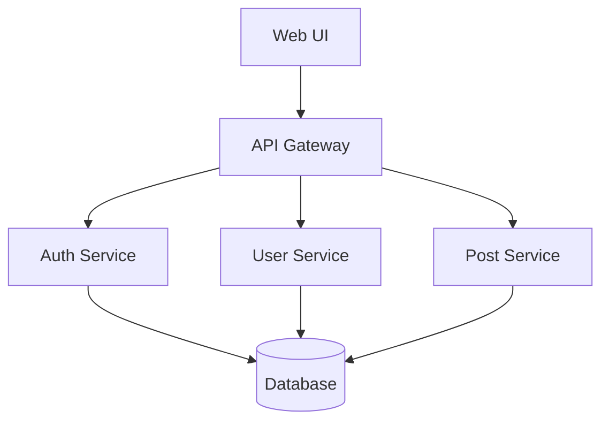
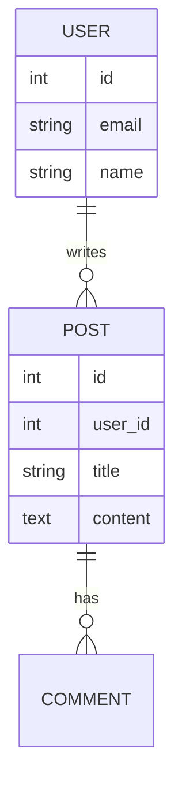

# 機能: アーキテクチャ設計

> 前提: 呼び出し元（SKILL.md）の「設定の読み込み」で `./.engineer-assistant/config.yaml` を読み込み済み。
> 未読込なら先に読むこと。本ファイル内の `config.xxx` はその値を指す。


システム構成・データフロー・コンポーネント設計。

## 手順

### 1. 要件把握

要件定義 + 非機能要件を読み込む。

### 2. アーキテクチャパターン選定

#### 規模・特性別

小規模 / シンプル:
- モノリス
- クライアント-サーバー

中規模:
- レイヤードアーキテクチャ
- MVC / MVVM
- モジュラーモノリス

大規模 / 複雑:
- マイクロサービス
- イベント駆動
- CQRS / Event Sourcing

#### 要求別

読み取り中心:
- キャッシュ活用
- CDN
- 読み取りレプリカ

書き込み中心:
- 非同期処理
- キュー
- Sharding

リアルタイム:
- WebSocket
- Server-Sent Events

### 3. 構成図

ASCII 図 or Markdown で:

```
┌─────────────┐
│   Web UI    │
│  (React)    │
└──────┬──────┘
       │
       ▼
┌─────────────┐
│  API Gateway │
└──────┬──────┘
       │
   ┌───┴───┬──────┐
   ▼       ▼      ▼
┌────┐ ┌────┐ ┌────┐
│Auth│ │User│ │Post│
│Svc │ │Svc │ │Svc │
└────┘ └────┘ └────┘
   │       │      │
   └───┬───┴──────┘
       ▼
┌─────────────┐
│   Database   │
│  (Postgres)  │
└─────────────┘
```

または Mermaid:



### 4. 技術スタック決定

- フロントエンド
- バックエンド
- データベース
- キャッシュ
- メッセージキュー
- CI/CD
- 監視・ログ

→ `function-tech-selection.md` と連携

### 5. データモデル

主要エンティティの ER 図:



### 6. API 設計

```
GET    /api/users       # 一覧
GET    /api/users/:id   # 詳細
POST   /api/users       # 作成
PUT    /api/users/:id   # 更新
DELETE /api/users/:id   # 削除
```

### 7. 非機能への対応

- スケーラビリティ: 水平スケール可能な構成
- 可用性: 複数 AZ / リージョン
- セキュリティ: 認証・認可・暗号化
- 可観測性: ログ / メトリクス / トレース

### 8. ADR（Architecture Decision Record）

重要な技術判断を記録:

```markdown
# ADR-001: API Gateway として Kong を採用

## ステータス
承認済み

## 文脈
マイクロサービス構成で、認証・レート制限・ログを一元化したい

## 検討した選択肢
1. Kong
2. AWS API Gateway
3. 自前実装

## 決定
Kong を採用

## 理由
- オープンソースで柔軟
- プラグインエコシステム
- Kubernetes 親和性

## 結果
- 運用コスト: ...
- メリット: ...
- 懸念: ...
```

### 9. DA レビュー

`engineer-assistant-advocate` にアーキテクチャを渡してレビュー:
- スケーラビリティ
- セキュリティ
- 保守性
- 単一障害点

## やってはいけないこと

- 要件を超えた過度な設計
- マイクロサービス信仰（小規模なら不要）
- 最新技術の盲目的採用
- セキュリティの後回し
